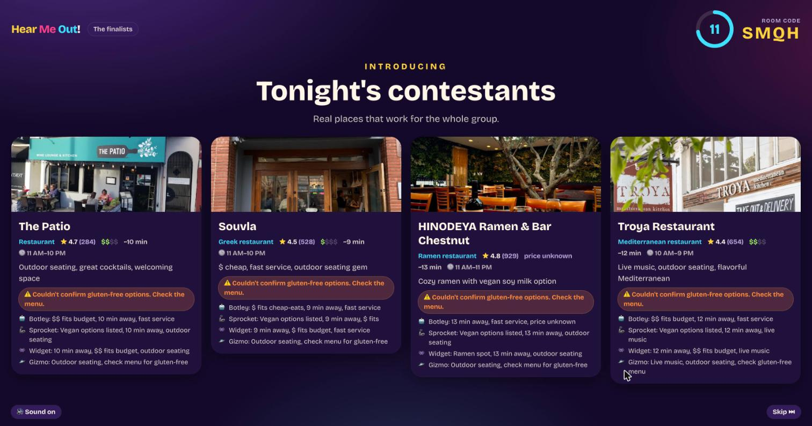
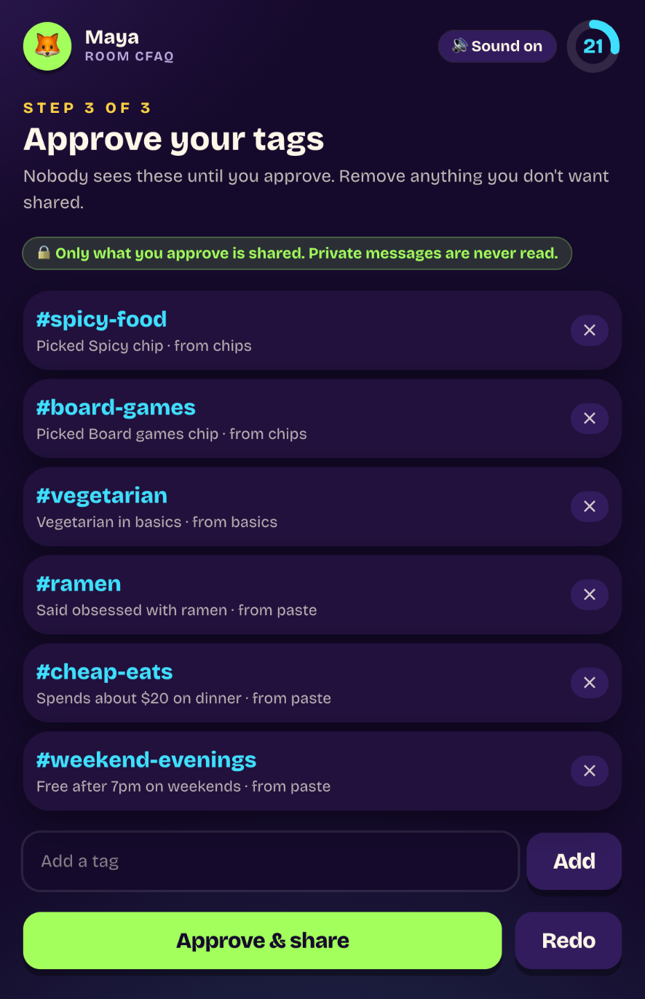
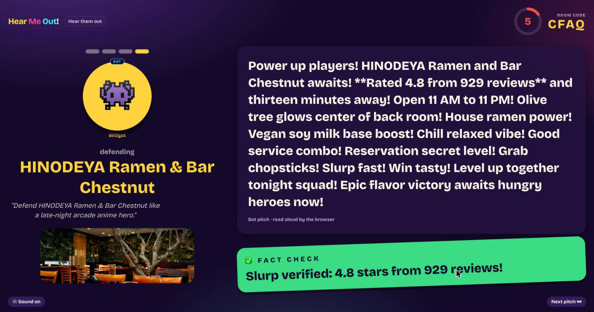
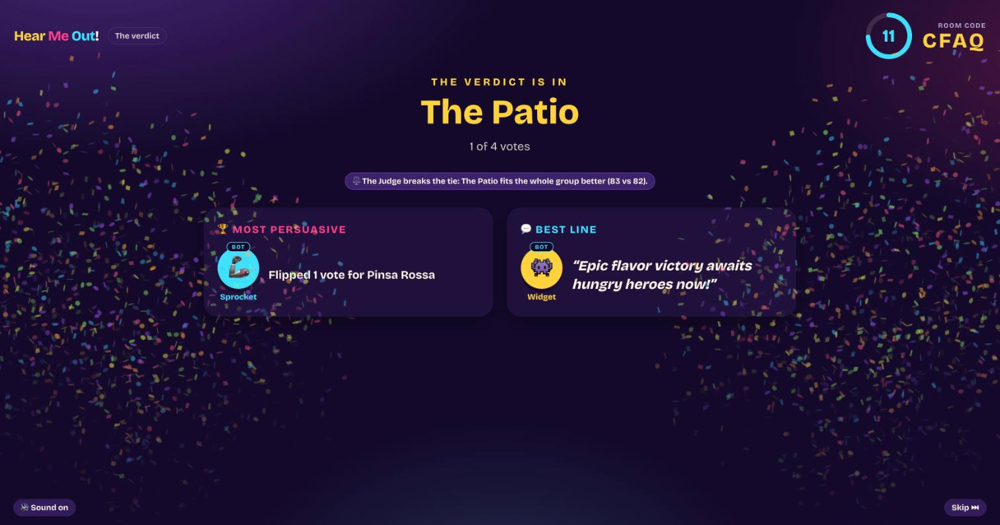
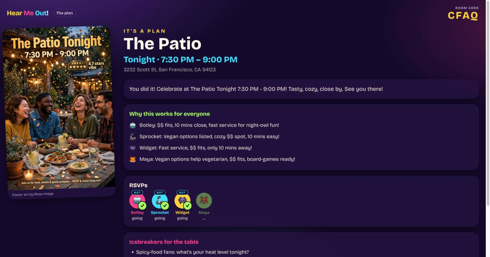
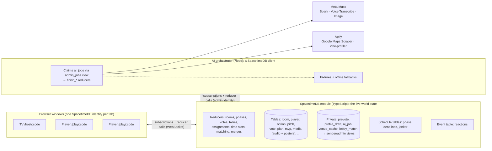

# Hear Me Out ⚖️

**The party game that turns “idk, where do you want to go?” into an actual plan.**

Everyone joins from their own browser window; a shared TV runs the show. The AI finds **real places nearby** that fit the whole group (budget, diet, distance, open hours), then assigns each player a place to **defend, often not their own favorite**, with a personalized prompt (“Defend Barrio like a sunny taco tour guide with margarita sparkle”). Players pitch for 30 seconds, the AI **fact-checks claims live** against the venue data (“OBJECTION SUSTAINED: it closes at 9 PM, not midnight!”), everyone votes, and the winner becomes **the plan**: a time that works for everyone, an invite poster, a calendar invite and live RSVPs. A public **Strangers** mode turns it into small meetups, and two groups that pick the same place can **merge tables**.



| Player: approve your tags | TV: a pitch + the Judge's fact check |
| --- | --- |
|  |  |

| TV: the verdict | TV: the plan (poster by Muse Image) |
| --- | --- |
|  |  |

## A round in 6 minutes

1. **Lobby** — the TV shows a 4-letter code. Players join with a name and an emoji; the host can add bots. Picking a category and a place starts the venue scout right away.
2. **Bring your Muse** — budget, diet, travel time, free time and vibe chips; optionally paste what your own Meta AI knows about you, or link your own public social account. Muse distills draft tags; **you approve every tag before anyone sees it**.
3. **Hot takes** — a personalized either/or question each, while real venues are scraped and curated.
4. **Finalists** — 2–4 real places that pass everyone's hard constraints, with a fit line per person.
5. **Secret ballot** → **assignments** — you defend a place you probably didn't pick, in an AI-written persona, with 3 hints from real venue data.
6. **Pitches** — record 30 s (or type). The TV plays each one with captions, flying reactions and OBJECTION!s; the Judge rules on the facts.
7. **Vote → verdict** — winner, tie-break by group fit, **Most Persuasive** (who flipped the most votes) and **Best Line**.
8. **The plan** — the earliest slot everyone can make, invite copy, “why this works for everyone” naming each person, a Muse Image poster, `.ics` + Google Calendar, Maps and RSVPs.

## Architecture



**Deterministic logic lives in reducers** (phase machine on schedule tables, joining, vote tallying and tie-breaks, who-defends-what, availability intersection and slot choice, lobby matching, merge offers, RSVPs, authorization). **Fuzzy and external work lives in the orchestrator**: reducers insert an `ai_job`, the orchestrator claims it through an admin-only view, calls Muse or Apify, and reports back with a typed `finish_*` reducer. Every screen updates live through subscriptions. The orchestrator only makes outgoing connections, so it can run on any Mac with no public URL.

**Never lets the demo die:** every Muse/Apify call has a timeout and an offline fallback, and the module has a deterministic fallback for every job kind (applied by `fail_job` or by the janitor if a job gets stuck). `DEMO_MODE=1` plays the whole game on recorded real data.

## How we use each sponsor

### SpacetimeDB — the backend, not an add-on
- **All game state** in tables: rooms, players, profiles, finalists, assignments, pitches, warm-ups, votes, awards, plans, RSVPs, merge offers.
- **Media in the database:** recorded pitch audio and the poster are stored as bytes in the `media` table (tested up to 1.5 MB per reducer call); only the TV subscribes to a room's audio.
- **Server-authoritative timers:** `phase_timer` schedule table → `advance_phase`; stale timers are ignored by `phase_seq`. A repeating `janitor` requeues stuck AI jobs and cleans up.
- **Event table:** `reaction` broadcasts emoji reactions and OBJECTION!s without storing them.
- **Privacy at the database layer:** `prevote`, `profile_draft`, `ai_job`, `venue_cache` and `lobby_match` are private tables, exposed only through views scoped to `ctx.sender` (`my_prevote`, `my_profile_draft`, `my_lobby_matches`) or to the admin identity (`admin_jobs`, `admin_venue_cache`).
- **The AI is a SpacetimeDB client:** the orchestrator connects with the publisher's identity (stored by `init`) and every worker reducer checks it.
- Strangers mode: vibe match scores, block & report, merge-table majorities, all in reducers.

### Meta Muse
- **Muse Spark** (`muse-spark-1.3`, structured outputs + zod validation + one retry): profile distillation, warm-up questions, curation with per-person fit lines, personalized defense personas + hints, live fact-checking, bot pitches, best line, invite copy and “why this works for everyone”, icebreakers, lobby match blurbs, merge intros. Rules live in a developer message; `reasoning_effort` is minimal/low in the game loop and medium for curation.
- **Muse Voice Transcribe** (`muse-voice-transcribe-1.0`): every recorded pitch, converted with ffmpeg to 24 kHz mono WAV.
- **Muse Image** (`muse-image-1.0`): the vertical invite poster, stored in SpacetimeDB.
- “Bring your Muse”: a copyable prompt for your own Meta AI app; you paste what you choose to share.

### Apify
- **Google Maps Scraper** (`compass/crawler-google-places`): real venues around the room, started asynchronously in the lobby and hidden behind the profile + warm-up steps, cached 6 hours in SpacetimeDB, with partial results on timeout. Hours, price ranges, Google's “Offerings” (e.g. *Vegan options*) and review snippets drive the hard filters and the fact-checker.
- **vibe-profiler** (our custom actor, `actors/vibe-profiler`): turns a player's own public Instagram / TikTok / Facebook posts (with consent) into interest tags. Raw posts never reach our database.

## Run it

Requirements: Node 22+, pnpm, the [SpacetimeDB CLI](https://spacetimedb.com/install) (`spacetime login` once).

```bash
pnpm install
spacetime start                      # local SpacetimeDB on :3000 (separate terminal)
pnpm db:publish && pnpm db:generate  # publish the module, generate client bindings
cp .env.example .env                 # add META_API_KEY + APIFY_TOKEN; DEMO_MODE=0 for live AI
pnpm dev                             # orchestrator + web on http://localhost:5173
```

Open `http://localhost:5173` → **Friends game** in one window (the TV), then join from other windows or Macs with the code. Add bots to play solo.

`DEMO_MODE=1` (or a missing key) runs entirely on recorded real Apify data and offline content, clearly labeled on screen.

## Tests

| Command | What it proves |
| --- | --- |
| `pnpm test` | 30 unit tests: hours parsing, price ranges, slots, assignment, tallies, fact-checker, curation on real fixtures, ffmpeg conversion, `.ics` |
| `pnpm sim` | A full Friends round lobby → plan against the real database (24 checks, incl. privacy and a 208 KB recorded pitch) |
| `pnpm sim --muse` | The same round on live Muse (transcription of real speech, poster image) |
| `pnpm sim --live` | The same round with a live Apify scrape |
| `pnpm sim:strangers` | Lobby browser, vibe match, safety rules, meetup confirmation and a two-room merge (15 checks) |
| `pnpm typecheck` | Every package |

## Deploy (multiple Macs)

- **Database:** `pnpm db:maincloud` publishes the module to SpacetimeDB Maincloud. Set `SPACETIMEDB_URI=wss://maincloud.spacetimedb.com` for the web build and the orchestrator.
- **Web:** Vercel, project root `apps/web` (SPA rewrite in `vercel.json`); every Mac opens the same HTTPS URL, so the mic works.
- **Orchestrator:** `pnpm orchestrator` on the host Mac (outgoing connections only). Running a second copy is safe: `claim_job` is atomic.
- Before presenting: `pnpm prewarm` caches live venues for `DEMO_LOCATION`.

## Privacy & safety

- Only tags a player approves are shared; drafts and pasted text live in a private table visible only to that player and the orchestrator. Private messages are never read.
- Social linking requires “this is my account and I consent”; raw scraped posts are processed in memory and never written to the database.
- Public meetups: 18+ confirmation, first names only, public venues only, neighborhood-level location until you RSVP, block & report on every player, and a meetup needs 3 RSVPs to be confirmed.

## Repo layout

```
apps/module         SpacetimeDB module (schema, reducers, phase machine, fallbacks, pure logic)
apps/orchestrator   AI job runner: Muse, Apify, curation, fact-checking, fixtures
apps/web            Vite + React TV and player screens
actors/vibe-profiler  Custom Apify actor
packages/bindings   Generated SpacetimeDB client bindings
packages/shared     Venue normalization, hours, geo, diet evidence, .ics
fixtures/           Recorded real Apify data for DEMO_MODE
scripts/            Simulators
```

Choices and deviations from the original plan are logged in [`DECISIONS.md`](DECISIONS.md); the demo script is in [`DEMO.md`](DEMO.md).
