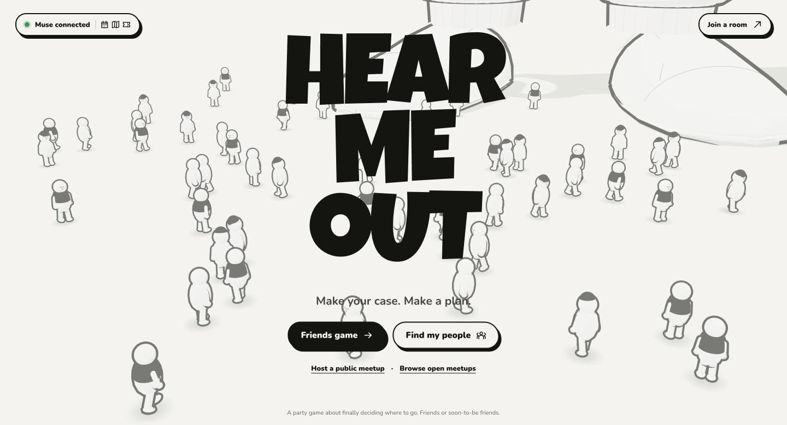
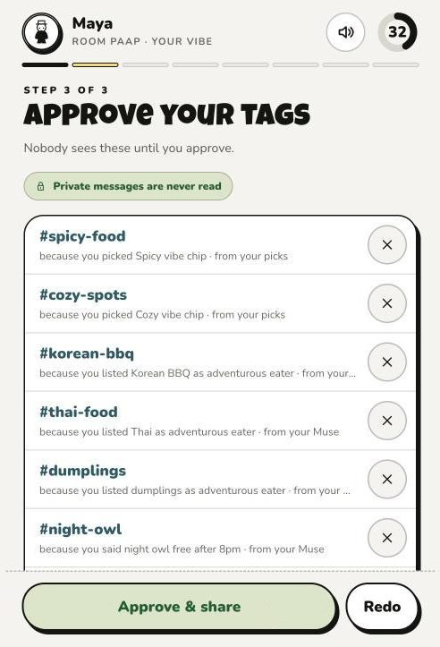
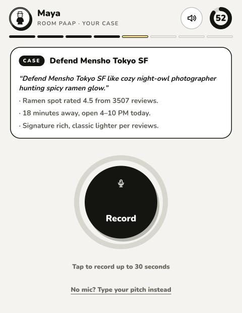
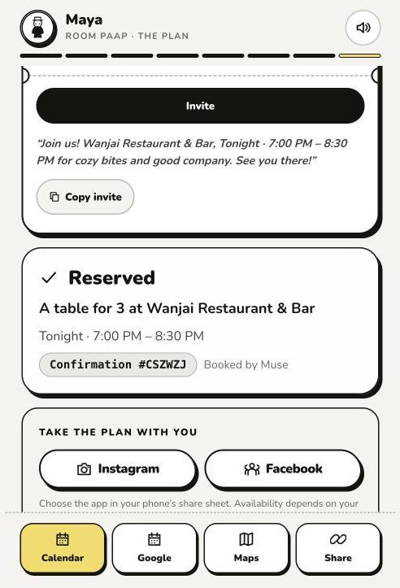
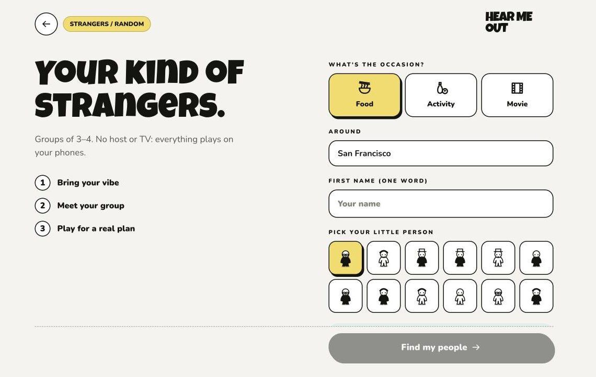
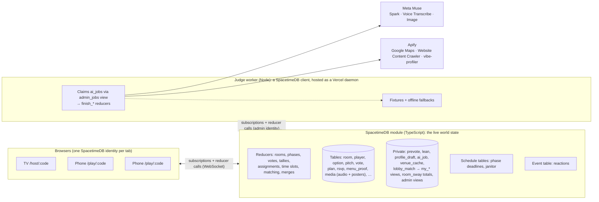

# Hear Me Out ⚖️

**The party game that turns "idk, where do you want to go?" into an actual plan.**

Play it at **https://hear-me-out-jose.vercel.app**.

Play with friends you already have, or use **Find my people** to meet new people nearby. The AI host (the Judge) finds **real places nearby** that fit the whole group: budget, diet, distance and open hours. Each player is assigned a place to **defend, usually not their own favorite**, with a style to argue in and real facts to use. Pitches last up to 30 seconds. While they play, listeners react, lean toward a place on a **live sway meter**, and object, and the Judge **fact-checks claims** against the venue data ("OBJECTION SUSTAINED: closes at 10 PM, not 2am!"). Everyone votes privately, and the winner becomes **the plan**: a time that works for everyone, an invite, a poster, a calendar event and RSVPs you can share to Instagram or Facebook.



| TV: tonight's contestants | TV: a pitch, the Judge's ruling and the live sway |
| --- | --- |
|  |  |

| Phone: approve your tags | Phone: your case file | Phone: the plan |
| --- | --- | --- |
|  |  |  |

| TV: the verdict | TV: the plan |
| --- | --- |
|  |  |

*Screenshots are from a live game on the deployed site: real Google Maps places in Hayes Valley, San Francisco, with live Muse and Apify calls.*

## A round

1. **Lobby.** The TV shows a 4-letter room code and players join from their phones (up to 8, and the host can add bots). The host picks Food, Activity or Movie and a place, which starts the live venue search right away.
2. **Your vibe.** Each player sets a budget, how far they'll travel, when they're free tonight, any dietary needs and a few vibe chips. Then comes the Muse step, and they can optionally link their own public Instagram, TikTok or Facebook page. Muse Spark drafts interest tags with a reason for each, and **you approve every tag before anyone sees it**.
3. **Hot takes.** A personalized either/or question for each player while real venues are scraped and curated.
4. **Finalists.** Two to four real places that pass everyone's hard constraints, each with a photo, rating, price, travel time, hours and a fit line per person.
5. **Secret ballot, then case files.** Everyone privately picks a favorite. Then each player gets a place to defend, usually not their pick, with a style to argue in and three facts from the real venue data. Extra players become co-counsel.
6. **Pitches.** Record up to 30 seconds (captioned by Muse Voice Transcribe) or type a pitch (read aloud by the browser). During playback, listeners react (Funny, Good point, Not convinced), privately lean toward a place, and can object. The TV shows only the anonymous sway totals and who is most persuasive right now. The Judge rules on claims about hours, ratings, reviews and price, and checks diet claims against dishes on the venue's own website.
7. **Vote and verdict.** One private vote each, for the place and not the person. The verdict shows the winner, ties broken by group fit, plus **Most Persuasive** (who swung the most people) and **Best Line**.
8. **The plan.** The earliest slot everyone can make, nudged away from the busiest hours using Google's popular times. It comes with invite copy, a fit line for each person, a Muse Image cover, RSVPs (I'm in, Maybe, Can't), a `.ics` file and a Google Calendar link, Maps directions, icebreakers for the table, and sharing to Instagram or Facebook.

## Find my people (strangers mode)



Pick an occasion, an area, a first name and a little person, then build your vibe like above. The queue puts **3 or 4 people who share the most approved tags** into a host-less room, and the whole game runs on their phones. Public meetups are 18+, use first names only, meet at public venues, and show the exact address only after you RSVP. Three "I'm in"s confirm a meetup, every player can be blocked or reported, and two groups that pick the same place can vote to **merge tables**. There are also open public lobbies to host or browse from the home page.

## Architecture



**Deterministic logic lives in reducers:** the phase machine on schedule tables, joining, vote tallying and tie-breaks, who defends what, availability intersection and slot choice, lobby and queue matching, merge offers, RSVPs and authorization. **Fuzzy and external work lives in the Judge worker.** A reducer inserts an `ai_job`, the worker claims it through an admin-only view, calls Muse or Apify, and reports back with a typed `finish_*` reducer. Every screen updates live through subscriptions. The worker only makes outgoing connections, so it runs anywhere: as a Vercel daemon next to the site, or on a laptop.

**The game never stalls:** every Muse and Apify call has a timeout and an offline fallback, and the module has a deterministic fallback for every job kind (applied by `fail_job`, or by the janitor if a job gets stuck). `DEMO_MODE=1` plays the whole game on recorded real data.

## How we use each sponsor

### SpacetimeDB: the backend, not an add-on
- **All game state** lives in tables: rooms, players, profiles, finalists, assignments, pitches, leans, warm-ups, votes, awards, menu proofs, plans, RSVPs and merge offers.
- **Media in the database:** recorded pitch audio and the Muse Image poster are stored as bytes in the `media` table, and only the TV subscribes to a room's audio.
- **Server-authoritative timers:** the `phase_timer` schedule table calls `advance_phase`, and stale timers are ignored by `phase_seq`. Phases also end early once everyone is ready. A repeating `janitor` requeues stuck AI jobs and cleans up.
- **Event table:** `reaction` broadcasts reactions and OBJECTION!s without storing them.
- **Privacy at the database layer:** `prevote`, `lean`, `profile_draft`, `ai_job`, `venue_cache` and `lobby_match` are private tables. They are exposed only through views scoped to `ctx.sender` (`my_prevote`, `my_lean`, `my_profile_draft`, `my_lobby_matches`), as anonymous totals (`room_sway`), or to the admin identity (`admin_jobs`, `admin_venue_cache`).
- **The AI is a SpacetimeDB client:** the worker connects with the publisher's identity (stored by `init`), and every worker reducer checks it.
- **Strangers mode:** the matchmaking queue, block and report, and merge-table majorities all run in reducers.

### Meta Muse
- **Muse Spark** (`muse-spark-1.3`, structured outputs, zod validation and one retry): profile tags, warm-up questions, curation with per-person fit lines, case-file styles and hints, live fact-checking, bot pitches, best line, invite copy, icebreakers, lobby match blurbs and merge intros.
- **Muse Voice Transcribe** (`muse-voice-transcribe-1.0`): every recorded pitch, converted with ffmpeg to 24 kHz mono WAV.
- **Muse Image** (`muse-image-1.0`): the event cover on the plan, stored in SpacetimeDB.
- The Muse account connection, its connectors and the table booking shown in the UI are simulated in this build (see `DECISIONS.md` #40): nothing is read from anyone's accounts and nothing is booked.

### Apify
- **Google Maps Scraper** (`compass/crawler-google-places`): real venues around the room, scraped live for every game. The scrape starts in the lobby and runs while players fill in profiles and hot takes, and returns partial results if it hits its 85-second cap. Hours, price ranges, Google's "Offerings" (e.g. *Vegan options*), review snippets and popular times drive the filters, the fact-checker and the plan time.
- **Website Content Crawler** (`apify/website-content-crawler`): reads each finalist's own website to find real dishes that back up diet claims.
- **vibe-profiler** (our custom actor, `actors/vibe-profiler`): turns a player's own public Instagram, TikTok or Facebook posts (with consent) into interest tags. Raw posts never reach our database.

## Run it locally

Requirements: Node 22+, pnpm, the [SpacetimeDB CLI](https://spacetimedb.com/install) (`spacetime login` once).

```bash
pnpm install
spacetime start                      # local SpacetimeDB on :3000 (separate terminal)
pnpm db:publish && pnpm db:generate  # publish the module, generate client bindings
cp .env.example .env                 # add META_API_KEY + APIFY_TOKEN; DEMO_MODE=0 for live AI
pnpm dev                             # worker + web on http://localhost:5173
```

Open `http://localhost:5173` and choose **Friends game** in one window (the TV), then join from other windows or phones with the code. Add bots to play solo.

`DEMO_MODE=1` (or a missing key) runs entirely on recorded real Apify data and offline content, clearly labeled on screen.

## Tests

| Command | What it proves |
| --- | --- |
| `pnpm test` | 129 unit tests: hours parsing, prices, slots, assignment, tallies, fact-checker, menu evidence, curation on real fixtures, category rules, ffmpeg conversion, `.ics`, the worker runner |
| `pnpm sim` | A full Friends round from lobby to plan against a real local database (36 checks, including privacy and a recorded pitch) |
| `pnpm sim --muse` / `pnpm sim --live` | The same round on live Muse, or with a live Apify scrape |
| `pnpm sim:strangers` | Lobby browser, vibe match, safety rules, meetup confirmation and a two-room merge (15 checks) |
| `pnpm sim:match` | Find my people: strangers queue, get matched into one server-owned room and confirm a meetup (16 checks) |
| `pnpm exec tsx scripts/sim-completion.ts`, `scripts/sim-categories.ts` | Typed-pitch audits of complete Food, Activity and Movie games (need the local fixture worker running) |
| `cd actors/vibe-profiler && npx vitest run --config vitest.config.ts` | 49 tests for the vibe-profiler actor (normalization, enrichment, Muse parsing) |
| `pnpm demo:player CODE Name [pitch.webm]` | A scripted player that joins a real room from the terminal (handy for solo testing) |
| `pnpm typecheck` | Every package |

## Deploy

- **Database:** publish the module to SpacetimeDB Maincloud (`pnpm db:maincloud`). The site and the worker must use the same database name.
- **Hosted (recommended):** import the repo into Vercel with the project root at the repo root. `vercel.json` builds the site and runs the Judge worker as a Vercel daemon from `Dockerfile.worker`, so no laptop has to stay open. Secrets (`META_API_KEY`, `APIFY_TOKEN`, `SPACETIMEDB_TOKEN`) stay in Vercel's environment settings. Full steps and checks are in [`docs/VERCEL.md`](docs/VERCEL.md).
- **Static site with a laptop worker:** run `pnpm web:build:maincloud`, then `npx vercel deploy apps/web/dist --prod`, and keep `pnpm orchestrator` running on one machine. A second worker is safe because `claim_job` is atomic.
- Every game runs a live Apify scrape (results are never reused), so pick the place early in the lobby. A scrape takes up to about 85 seconds and falls back to recorded venues if it fails.

## Privacy & safety

- Only tags a player approves are shared. Drafts and pasted text live in a private table that only that player and the worker can see. Private messages are never read.
- Linking a social account requires confirming "this is my account and I consent". Scraped posts are processed in memory and never written to the database.
- Leans and secret picks are private: the TV only ever sees totals.
- Public meetups: 18+ confirmation, first names only, public venues only, neighborhood-level location until you RSVP, block and report on every player, and 3 RSVPs to confirm a meetup.

## Repo layout

```
apps/module           SpacetimeDB module (schema, reducers, phase machine, fallbacks, pure logic)
apps/orchestrator     The Judge worker: Muse, Apify, curation, fact-checking, menu check, fixtures
apps/web              Vite + React TV and phone screens
actors/vibe-profiler  Custom Apify actor
packages/bindings     Generated SpacetimeDB client bindings
packages/shared       Venue normalization, hours, geo, diet and menu evidence, .ics
fixtures/             Recorded real Apify data for DEMO_MODE
scripts/              Simulators and audits
vercel.json, Dockerfile.worker   Hosted site + worker on Vercel
```

Choices and deviations from the original plan are logged in [`DECISIONS.md`](DECISIONS.md), and the demo script is in [`DEMO.md`](DEMO.md). Contributors and coding agents start at [`AGENTS.md`](AGENTS.md).
