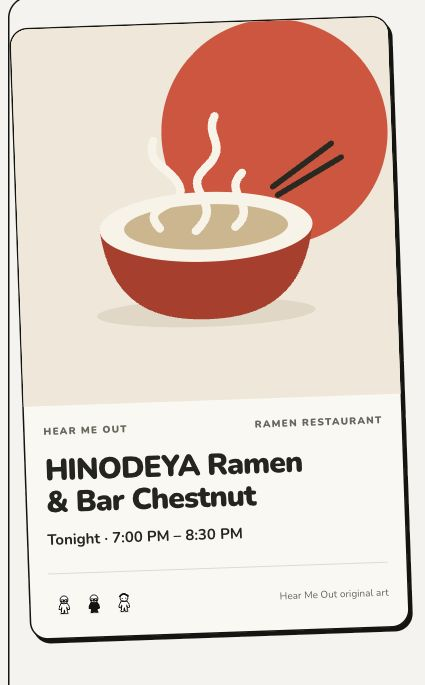
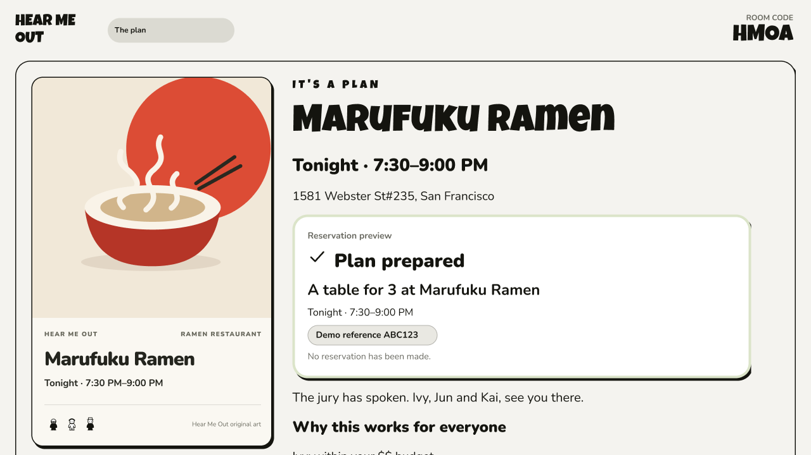

# Final game and design verification — 2026-10-24

The Friends, hosted-public and phone-only matched games completed against the local SpacetimeDB using offline AI/venue fixtures and typed human pitches. Verified profile approval, private/final voting, playback, all three labeled reactions, Objection, results, RSVP/address gates, calendar download and a real six-person merge. The matched run’s final ballot timed out and exercised the tiebreak; other games cast final votes. Reload+Redo preserved nondefault budget/diet/travel/time constraints in read-only SQL. Add to calendar produced a validated 675-byte ICS file; no account event was saved.

The final app replaces ornate image-generated flyers with a shared host/phone invitation. Muse Image receives controlled square, text-free art direction: one focal object, a limited palette, negative space and no invented venue claims. Exact venue/category/time are rendered as native text. Legacy or failed images use original category-appropriate SVG artwork. Eight new tests cover the prompt contract, storage limit, legacy replacement and mocked provider boundary. No paid image call was made in this verification pass. [Luma’s event presentation](https://luma.com/discover) informed the visual direction.

Two upstream commits arrived during QA and were preserved in a merge: Muse/ballot UI and WhatsApp backend support. The optional sample-profile animation, connector modal and reservation animation are now labeled demos/previews; they do not access accounts or make bookings. Manual context remains available. Fresh-browser checks passed sample loading/completion, Back/Next preservation, modal open/Close, Leave queue and the completed reservation preview. The reservation preview includes affirmative RSVPs from both merged groups; the real merged plan shows six. The final full-photo ballot appearance was source/build checked and clicked in Figma; another complete app game using that final appearance was not run. The new WhatsApp backend passes unit tests but was not published to the local DB and has no frontend yet.

[Figma prototype](https://www.figma.com/proto/SUJ7QsIwkSRdHrGvY7ZG8L?node-id=70-157&starting-point-node-id=70%3A157 ): 143 frames, 712 inspected controls, 137 valid unique destinations, none missing. Native browser verification covered 28 baseline cases plus seven focused Muse/ballot/preview checks. Fixed opacity units, conditional selection, feedback clipping and host layout; updated all 17 poster states, source avatars, full-photo ballots and the new previews. Native variables and recorded fixtures simulate backend/input/timer outcomes; actual multiplayer, recording, AI and downloads execute in the app.

Final validation:

- `pnpm test`: 48/48 passed across six files.
- Workspace typecheck and final production frontend build passed.
- Final source diff whitespace check passed; the build retains its existing >500kB chunk warning.
- Microphone capture, paid Muse/Apify calls and external account imports were not exercised. No messages, bookings, purchases or calendar saves were made.

Detailed screenshots, SQL/download receipts, native control ledgers and Figma wiring receipts remain in the local workspace at `docs/figma-reconciliation/e2e/`; raw generation/audit files are intentionally outside this source commit.
